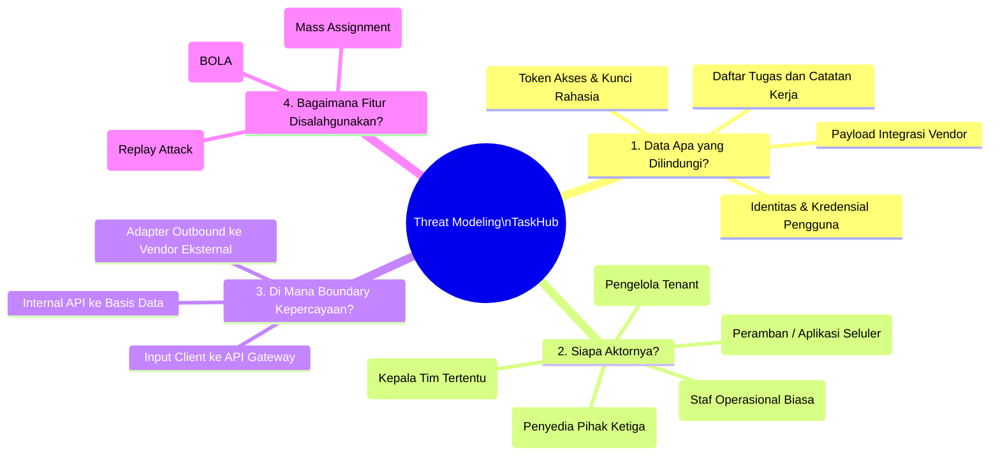
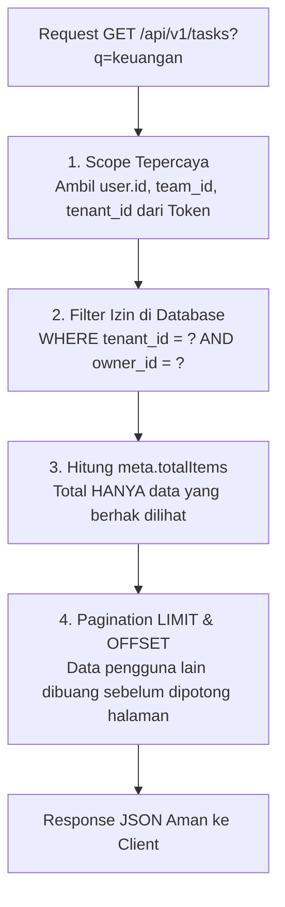

# 🛡️ Modul 01: Threat Modeling & Mitigasi BOLA / IDOR
**Rujukan Slide: Slide 6 – 14**

Modul ini membahas cara mengidentifikasi potensi penyalahgunaan sistem (*abuse case*) menggunakan metode pemodelan ancaman (*Threat Modeling*) serta mengimplementasikan kontrol otorisasi level objek (*Object Level Authorization*) untuk menutup celah keamanan paling berbahaya pada API modern: **BOLA (Broken Object Level Authorization)** dan **IDOR (Insecure Direct Object Reference)**.

---

## 🧐 1. Empat Pertanyaan Awal Threat Modeling (Slide 7)

Keamanan perangkat lunak yang tangguh tidak dibangun dari asumsi acak, melainkan dari metodologi sistematis *Security by Design*. Empat pertanyaan awal yang wajib diajukan oleh arsitek perangkat lunak sebelum menulis kode:



---

## ⚠️ 2. Tujuh Ancaman Nyata di TaskHub (Slide 9 & 10)

Berdasarkan analisis arsitektur TaskHub, ditemukan **tujuh vektor penyalahgunaan utama**:

| No | Vektor Penyalahgunaan (*Abuse Case*) | Risiko Keamanan | Rujukan Slide |
| :---: | :--- | :--- | :---: |
| **1** | **Member membaca tugas milik pengguna atau tim lain** | Kebocoran data objek (*BOLA / IDOR*) | Slide 11 – 14 |
| **2** | **Client menyisipkan field internal (`role`, `is_admin`, `owner_id`) di badan request** | Perubahan dan eskalasi kewenangan (*Mass Assignment*) | Slide 20 – 22 |
| **3** | **Percobaan login berulang atau pengiriman payload raksasa** | Kehabisan sumber daya komputasi (*Resource Exhaustion / DoS*) | Slide 21, 25 – 28 |
| **4** | **Peramban asing mengeksekusi request lintas domain dengan kredensial tersimpan** | Aksi lintas origin tanpa izin (*CORS / CSRF*) | Slide 29 – 31 |
| **5** | **Kunci rahasia atau token tidak sengaja ter-commit ke Git atau tercetak di log** | Kredensial terekspos ke publik (*Credential Exposure*) | Slide 24, 44 – 46 |
| **6** | **Penyedia eksternal lambat atau mengalami gangguan sehingga antrean server menumpuk** | Kegagalan berantai (*Cascading Failure / Outage*) | Slide 48, 58 – 64 |
| **7** | **Percobaan ulang (*retry*) transaksi dilakukan tanpa kunci penjamin satu kali proses** | Duplikasi efek bisnis / pembayaran ganda (*Duplicate Intent*) | Slide 53, 56 – 57 |

### Matriks Penilaian Risiko (Slide 10)
Setiap ancaman diprioritaskan berdasarkan **Dampak** (*Impact*) dan **Kemungkinan** (*Likelihood*):
- **Dampak**: Data milik siapa yang terekspos? Seberapa parah kerugian bisnis? Seberapa luas gangguan operasional?
- **Kemungkinan**: Hak akses apa yang dibutuhkan pelaku? Seberapa mudah jalurnya dieksploitasi? Kontrol apa yang sudah berjalan?

> [!IMPORTANT]
> **Kontrol Harus Ditegakkan di Server (Slide 10)**
> *“Tombol tersembunyi di antarmuka pengguna (UI) BUKAN otorisasi!”*
> Menyembunyikan tombol *Delete* atau menu *Edit* di frontend tidak melindungi API. Penyerang dapat langsung mengirimkan perintah HTTP `DELETE /api/v1/tasks/:id` melalui terminal `curl` atau Postman. Seluruh pemeriksaan wewenang **wajib** divalidasi di sisi backend Express.

---

## 🚪 3. BOLA dan IDOR: Akses Objek yang Tidak Berhak (Slide 11)

- **BOLA (*Broken Object Level Authorization*)**: Celah di mana pengguna dengan identitas sah (*authenticated*) berhasil memanipulasi atau melihat data milik pengguna lain karena server lupa memeriksa apakah pengguna tersebut berhak atas objek spesifik itu.
- **IDOR (*Insecure Direct Object Reference*)**: Salah satu manifestasi teknis BOLA di mana pengguna cukup mengganti nilai referensi identitas (misal: mengganti ID di URL dari `/tasks/task-alice-101` menjadi `/tasks/task-bob-201`).

```
                    ┌────────────────────────────┐
                    │  Token Bearer Sah? (AuthN) │
                    └─────────────┬──────────────┘
                                  │ YA
                                  ▼
                    ┌────────────────────────────┐
                    │   BOLA / IDOR Terjadi Bila: │
                    │ Server langsung query DB   │
                    │ tanpa cek wewenang objek:  │
                    │ SELECT * FROM tasks        │
                    │ WHERE id = :taskId; ◄──────┼─── KESALAHAN FATAL!
                    └────────────────────────────┘
```

> [!CAUTION]
> **Mitos Keamanan (Slide 11):**
> *"Aplikasi saya aman karena sudah pakai Bearer Token valid dan ID-nya berupa UUID acak yang panjang!"*
> **FAKTA:** Token valid hanya membuktikan **siapa Anda** (*Autentikasi*), bukan **apa yang boleh Anda sentuh** (*Otorisasi*). UUID acak hanyalah bentuk pengaburan (*Security through Obscurity*). Jika penyerang mendapatkan ID tersebut melalui riwayat log, cache peramban, referer header, atau respon API lain, mereka tetap dapat mengeksploitasi objek jika server tidak memiliki kebijakan otorisasi.

---

## 🧪 4. Uji BOLA: Lima Operasi, Satu Hasil yang Sama (Slide 12)

Dalam pengujian keamanan komprehensif, evaluasi BOLA tidak boleh hanya dilakukan pada satu endpoint. Seluruh operasi CRUD dan aksi khusus terhadap objek harus diuji:

```
                          ┌─────────────────────────────┐
                          │   Aktor: BOB (Member Tim B) │
                          └──────────────┬──────────────┘
                                         │ Mencoba mengakses Task ALICE (Tim A)
            ┌────────────────────────────┼────────────────────────────┐
            ▼                            ▼                            ▼
      1. Detail (GET)              2. Update (PATCH)            3. Delete (DELETE)
   GET /tasks/alice-101         PATCH /tasks/alice-101       DELETE /tasks/alice-101
      [DITOLAK 403]                [DITOLAK 403]                [DITOLAK 403]
            │                            │                            │
            └────────────────────────────┼────────────────────────────┘
                                         │
            ┌────────────────────────────┴────────────────────────────┐
            ▼                                                         ▼
     4. Notify (POST)                                         5. Collection (GET)
POST /tasks/alice-101/notify                                      GET /tasks
      [DITOLAK 403]                                       [Filter Izin: 0 Data Bocor]
```

### Uji Wewenang Lintas Tim (Cross-Team Test) (Slide 12)
Skenario laboratorium TaskHub mendefinisikan aturan tim:
- **Charlie** adalah **Manager Tim A**.
- **Bob** adalah **Member Tim B**.
- Walaupun Charlie berstatus `manager`, Charlie **HARUS DITOLAK (403 Forbidden)** ketika mencoba mengakses tugas milik Bob di Tim B! Seorang manajer hanya berhak mengelola anggota di bawah timnya sendiri.

---

## 🔍 5. Filter Izin pada Collection & Pencarian (Slide 13)

BOLA tidak hanya terjadi pada pemanggilan single item (`/tasks/:id`). BOLA juga sering bocor secara halus pada endpoint daftar (*collection*), ekspor file, dan pencarian:



### Bahaya Bocornya `meta.totalItems`:
Jika Anda melakukan `SELECT COUNT(*) FROM tasks` tanpa filter wewenang, pengguna biasa bisa menebak ada berapa banyak total tugas rahasia di sistem walaupun daftar itemnya kosong. Oleh karena itu, query agregasi total items **wajib** menggunakan filter hak akses yang sama persis dengan query data.

---

## 💻 6. Bedah Kode Implementasi Kebijakan `can_access` (Slide 14)

Berikut adalah implementasi fungsi kebijakan murni dan middleware penegakan otorisasi di berkas `src/middleware/policy.js`:

```javascript
// src/middleware/policy.js

/**
 * Logika murni penegakan otorisasi level objek
 */
export function canAccessTask(user, task) {
  // 1. Batas Isolasi Multi-Tenant: Tolak jika tenant berbeda (Slide 13)
  if (user.tenant_id !== task.tenant_id) {
    return false;
  }

  // 2. Admin memiliki wewenang penuh di dalam tenant miliknya
  if (user.role === "admin") {
    return true;
  }

  // 3. Manager hanya berhak atas tugas milik anggota di tim yang sama (Slide 12)
  if (user.role === "manager") {
    return user.team_id === task.team_id;
  }

  // 4. Member biasa hanya berhak atas tugas miliknya sendiri
  if (user.role === "member") {
    return user.id === task.owner_id;
  }

  return false;
}

/**
 * Middleware Express yang dipasang di setiap rute objek (Slide 14)
 */
export function authorizeTaskAccess(actionName = "akses") {
  return (req, res, next) => {
    const task = findTaskById(req.params.id);

    if (!task) {
      return res.status(404).json({
        error: {
          code: "TASK_NOT_FOUND",
          message: "Tugas tidak ditemukan.",
          request_id: req.requestId,
        },
      });
    }

    // Periksa apakah user yang sedang aktif berhak atas task ini
    if (!canAccessTask(req.user, task)) {
      return res.status(403).json({
        error: {
          code: "BOLA_ACCESS_DENIED",
          message: `Akses ditolak: Anda tidak memiliki wewenang untuk ${actionName} tugas ini.`,
          request_id: req.requestId,
        },
      });
    }

    // Lampirkan task yang sudah terverifikasi ke objek req
    req.task = task;
    next();
  };
}
```

Dengan arsitektur ini, seluruh endpoint (`GET /:id`, `PATCH /:id`, `DELETE /:id`, dan `POST /:id/notify`) dijamin aman dari kebocoran BOLA dan IDOR!
