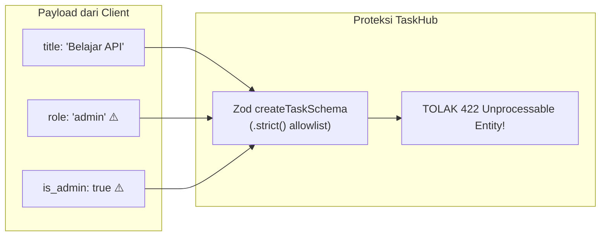

# 🛑 Modul 02: Kontrol Input, Mass Assignment & Error Handling
**Rujukan Slide: Slide 15 – 24**

Modul ini mengupas tuntas cara mengendalikan data yang masuk ke dalam sistem backend, mencegah manipulasi atribut wewenang (*Mass Assignment*), memisahkan data dari instruksi sistem (*Injection Prevention*), menata urutan kontrol input 5-tahap, serta merancang penanganan kesalahan (*Error Handling*) dan pencatatan log terstruktur (*Structured Logging*) yang aman.

---

## 💉 1. Serangan Injeksi: *"Data Tetap Data"* (Slide 16)

Serangan injeksi (seperti SQL Injection, Command Injection, Template Injection, atau LDAP Injection) terjadi ketika data masukan yang dikirim oleh pengguna ditafsirkan oleh sistem sebagai bagian dari **perintah atau instruksi pemrograman**.

> [!IMPORTANT]
> **Prinsip Utama Pertahanan Injeksi (Slide 16):**
> *“Data Tetap Data. Kontrol utama adalah memisahkan data pengguna dari bahasa yang dieksekusi sistem.”*
> Validasi format (seperti regex atau cek panjang string) memang membantu, tetapi **Parameter Binding (Prepared Statement)** adalah satu-satunya mekanisme yang menjamin data tidak akan pernah dieksekusi sebagai perintah.

---

## 🗄️ 2. Parameter Binding: Prisma & SQLite (Slide 17)

Perhatikan perbandingan mendasar antara kode yang rentan (*vulnerable*) dan kode yang aman:

```javascript
// ❌ CONTOH BERBAHAYA (SQL Injection Vulnerability - Slide 17):
// Menggabungkan string mentah langsung ke perintah SQL
const unsafeQuery = `SELECT * FROM tasks WHERE id = '${taskId}'`;
await prisma.$queryRawUnsafe(unsafeQuery);
// Jika taskId berisi: ' OR '1'='1 --
// Penyerang akan mendapatkan SELURUH data tugas di basis data!

// ✅ CONTOH AMAN (Parameter Binding - Slide 17):
// Nilai taskId dikirimkan secara terpisah dari struktur query
const task = await prisma.task.findUnique({
  where: { id: taskId },
});

// Atau pada raw query terparameterisasi:
const stmt = db.prepare("SELECT * FROM tasks WHERE id = ?");
const task = stmt.get(taskId); // taskId dikirim sebagai nilai murni!
```

> [!NOTE]
> **ORM Bukan Pengganti Otorisasi (Slide 17):**
> Menggunakan ORM (seperti Prisma, TypeORM, atau Sequelize) melindungi Anda dari SQL Injection dasar, tetapi **TIDAK** melindungi Anda dari BOLA atau Mass Assignment. Anda tetap wajib menuliskan logika otorisasi dan validasi skema secara eksplisit!

---

## 🚪 3. Sort, Shell, dan Upload: Batasi Pintu Masuk (Slide 18)

Tidak semua input pengguna bisa dimasukkan ke dalam parameter prepared statement biasa:

1. **Pengurutan (Sort Column)**:
   - Nama kolom pada klausa `ORDER BY` **tidak dapat di-bind** menggunakan placeholder `?` pada protokol SQL standar.
   - **Solusi Aman**: Buat pemetaan allowlist eksplisit (Allowlist Mapping) dari nama yang dikirim client ke nama kolom internal yang sah.
     ```javascript
     const sortAllowlist = {
       "waktu_buat": "created_at",
       "judul": "title",
       "versi": "version"
     };
     const safeColumn = sortAllowlist[req.query.sort] || "created_at";
     ```
2. **Eksekusi Shell (Command Execution)**:
   - Hindari penggunaan opsi `shell=True` atau fungsi `exec()` dengan input pengguna yang tidak disanitasi.
   - Gunakan `execFile()` dengan argumen array terpisah agar karakter shell (`|`, `;`, `&&`) tidak dieksekusi.
3. **Unggah Berkas (Upload File)**:
   - Batasi ukuran maksimum payload (*Payload Size Limit*).
   - Simpan berkas dengan nama acak baru di luar *web root*.
   - Jangan percaya ekstensi berkas atau `Content-Type` yang dikirimkan client tanpa validasi magic bytes.

---

## 🧪 4. Negative Testing Tanpa Serangan Nyata (Slide 19)

Pengujian keamanan pada lingkungan pengembangan (*Localhost*) bertujuan untuk membuktikan bahwa pertahanan bekerja dengan baik tanpa merusak integritas sistem:

1. **Input Tidak Sesuai Format**: Mengirimkan string yang melanggar tipe data atau panjang skema.
2. **Data Tetap Utuh**: Memeriksa kondisi basis data sebelum dan sesudah request dikirim untuk memastikan tidak ada perubahan liar (*Side Effect*).
3. **Error Terkendali**: Memastikan bahwa ketika sistem menolak request, respons yang dikembalikan **TIDAK** membocorkan nama tabel basis data, baris kode, query SQL mentah, atau *stack trace* internal ke client.
4. **Izin Tetap Berlaku**: Memastikan bahwa kegagalan format input tidak merusak status autentikasi atau membuka wewenang lintas pengguna secara tidak sengaja.

---

## 🎭 5. Mass Assignment: Field Internal Tidak Boleh Ditulis Client (Slide 20 & 21)

**Mass Assignment** adalah celah di mana client menyisipkan properti objek tambahan ke dalam JSON request, dan server langsung meneruskannya ke fungsi `db.insert()` atau `db.update()`.



### Dua Pilar Pertahanan (Slide 20):
1. **Request Allowlist**: Server hanya menerima field yang secara eksplisit diizinkan untuk ditulis oleh client (misal: hanya `title` dan `description`). Properti seperti `owner_id`, `role`, `team_id`, dan `is_admin` **wajib** ditetapkan secara internal oleh server dari token sesi yang sah!
2. **Output Serializer**: Jangan mengembalikan objek mentah dari basis data ke client tanpa penyaringan. Kolom internal sensitif seperti `password_hash`, salt, atau token sesi tidak boleh ikut keluar.

### Kasus Uji Laboratorium: Payload yang Wajib Ditolak (Slide 21):
- `role`, `owner_id`, `is_admin` ➔ Ditolak karena field internal / tidak dikenal (Status 422).
- `title` melebihi 100 karakter ➔ Ditolak karena melebihi batas skema (Status 422).
- Mengirimkan JSON Array `[{ "title": "test" }]` bukannya Object `{}` ➔ Ditolak karena tipe salah (Status 422).
- `status` di luar enum `open` / `done` ➔ Ditolak (Status 422).
- `version` bukan integer (misal `"satu"`) ➔ Ditolak (Status 422).

---

## 📶 6. Urutan 5 Lapisan Kontrol Input (Slide 22)

Untuk menghemat beban kerja server, setiap request HTTP yang masuk harus melewati urutan kontrol dari lapisan termurah (jaringan/transport) hingga lapisan termahal (basis data):

```
┌────────────────────────────────────────────────────────┐
│ 1. Kontrol Ukuran Body (Ukuran > 50KB?)                │ ➔ Tolak: 413 Payload Too Large
└──────────────────────────┬─────────────────────────────┘
                           │ Lolos
┌──────────────────────────▼─────────────────────────────┐
│ 2. Kontrol Content-Type (Bukan application/json?)      │ ➔ Tolak: 415 Unsupported Media Type
└──────────────────────────┬─────────────────────────────┘
                           │ Lolos
┌──────────────────────────▼─────────────────────────────┐
│ 3. Parse JSON Sintaks (Format JSON Cacat / Rusak?)     │ ➔ Tolak: 400 Bad Request
└──────────────────────────┬─────────────────────────────┘
                           │ Lolos
┌──────────────────────────▼─────────────────────────────┐
│ 4. Validasi Skema Zod (Field Terlarang / Tipe Salah?)  │ ➔ Tolak: 422 Unprocessable Entity
└──────────────────────────┬─────────────────────────────┘
                           │ Lolos
┌──────────────────────────▼─────────────────────────────┐
│ 5. Validasi Aturan Bisnis Domain (Optimistic Lock, dll)│ ➔ Tolak: 409 Conflict / 403 / Sukses 201
└────────────────────────────────────────────────────────┘
```

---

## 📦 7. Error Handler Konsisten & Structured Logging (Slide 23 & 24)

### Format Error Handler Standar (Slide 23)
Seluruh respons kesalahan di TaskHub diseragamkan melalui middleware error handling Express dengan struktur baku:

```json
{
  "error": {
    "code": "VALIDATION_ERROR",
    "message": "Payload yang dikirimkan tidak sesuai dengan skema kontrak API.",
    "request_id": "req_84f9b2d87e1a4c90"
  }
}
```
- **`code`**: Nilai string konstan yang stabil untuk dibaca oleh mesin/klien frontend.
- **`message`**: Deskripsi bahasa manusia yang mudah dipahami oleh pengguna.
- **`request_id`**: Kunci korelasi acak yang memungkinkan pengguna melaporkan masalah ke tim dukungan teknis tanpa membagikan kredensial atau token rahasia mereka!

### Pino Structured Logging (Slide 24)
Pino mencatat log dalam format JSON berkecepatan tinggi dengan atribut:
- `request_id`: ID korelasi unik.
- `method`: Metode HTTP (`GET`, `POST`, dll).
- `path`: Alamat endpoint **tanpa query string** (mencegah token yang salah tempat di query URL ikut tercatat!).
- `status`: Kode status HTTP.
- `latency_ms`: Waktu pemrosesan server dalam milidetik.

> [!CAUTION]
> **Larangan Mutlak Logging (Slide 24):**
> *“JANGAN PERNAH mencatat token Bearer, kata sandi, API key pihak ketiga, cookie sesi, atau signature webhook mentah ke dalam file log!”*
> Berkas `src/logger.js` di repositori ini telah dikonfigurasi dengan fitur **Redaction** otomatis untuk menyensor nilai-nilai sensitif tersebut menjadi `[REDACTED_RAHASIA]`.
