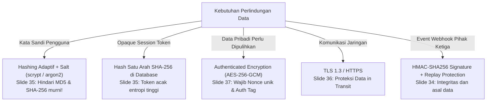
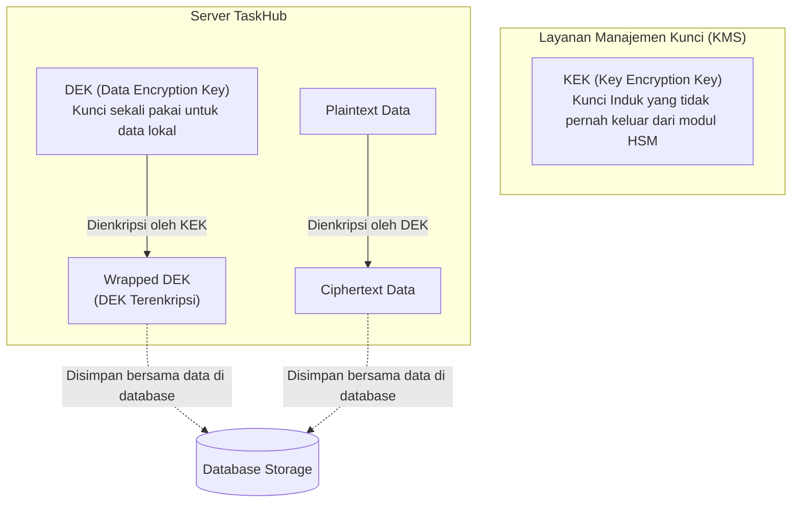

# 🔐 Modul 04: Kriptografi, Key Management & Secret Safety
**Rujukan Slide: Slide 32 – 46**

Modul ini membahas salah satu materi paling esensial dalam pelatihan Hari 2: pemilihan teknik perlindungan data secara tepat, implementasi enkripsi terotentikasi (*Authenticated Encryption*) **AES-256-GCM**, pembuktian deteksi manipulasi data (*tampering*), konsep enkripsi amplop (*Envelope Encryption*), serta tata kelola rahasia (*Secret Management*).

---

## 🧭 1. Empat Konsep Perlindungan Data Berbeda Fungsi (Slide 33)

Jangan pernah mencampuradukkan konsep-konsep ini karena masing-masing memberikan jaminan matematika yang sama sekali berbeda:

| Konsep | Karakteristik Utama | Dapat Dibalik? (*Reversible*) | Kunci (*Key*) | Contoh Penggunaan |
| :--- | :--- | :---: | :---: | :--- |
| **Encoding (Base64 / Hex)** | Mengubah representasi biner menjadi format teks agar aman ditransmisikan. **TIDAK ADA KERAHASIAAN!** | Ya, siapapun bisa men-decode tanpa password. | Tidak Ada | Menempelkan gambar ke JSON data URI, transmisi header HTTP. |
| **Hashing (Digest Satu Arah)** | Mengubah data dengan panjang berapapun menjadi string sidik jari digital (*fingerprint*) dengan panjang tetap. | **Tidak Bisa Dibalik** (One-Way). | Tidak Ada | Memvalidasi integritas file, verifikasi kata sandi (dengan salt), token lookup. |
| **Enkripsi (Encryption)** | Mengaburkan plaintext menjadi ciphertext sehingga hanya pihak yang memegang kunci yang dapat membaca teks aslinya. | **Bisa Dibalik** jika memiliki kunci yang tepat. | Kunci Rahasia (*Secret Key*) | Mengamankan data pribadi (PII), nomor kartu kredit, catatan rahasia tugas. |
| **Signature / MAC (HMAC)** | Memvalidasi **keaslian asal data** (*authenticity*) dan memastikan data **belum diubah** (*integrity*). Tidak menyembunyikan isi data! | Data tetap terbaca terang (*Plaintext*). | Kunci Penandatangan (*Signing Key*) | Tanda tangan webhook Stripe/GitHub, JWT Header.Payload.Signature. |

---

## 🎯 2. Menempatkan Teknik yang Tepat pada Arsitektur API (Slide 34)



---

## 👤 3. Mengapa Kata Sandi dan Token Disimpan Secara Berbeda? (Slide 35)

> [!CAUTION]
> **Bahaya Menggunakan Hash Cepat (MD5 / SHA-256) untuk Kata Sandi (Slide 35):**
> - **Karakteristik Kata Sandi**: Dibuat oleh manusia, cenderung pendek (8-16 karakter), dan memiliki entropi rendah. Perangkat keras komputer modern dapat mencoba **miliaran hash SHA-256 dalam hitungan detik** menggunakan kartu grafis (GPU) atau kamus kata sandi (*Rainbow Table*).
> - **Solusi Wajib (scrypt)**: Algoritme hashing lambat adaptif berbasis memori (*Memory-Hard*). Komputasi scrypt sengaja dibuat membutuhkan alokasi memori RAM dan siklus CPU yang besar sehingga peretas tidak bisa melakukan cracking paralel massal!
>
> - **Karakteristik Opaque Token**: Dihasilkan oleh mesin kriptografis CSPRNG (`randomBytes(32)`), menghasilkan entropi sangat tinggi ($2^{256}$ kemungkinan kombinasi acak). Mustahil ditebak dengan serangan kamus. Oleh karena itu, token opaque cukup disimpan dalam bentuk **hash SHA-256 standar** di database agar pencarian session lookup tetap cepat dan hemat sumber daya.

---

## 🚚 4. Data in Transit vs Data at Rest (Slide 36)

- **Data in Transit (Data Saat Berpindah di Jaringan)**:
  - Dilindungi oleh protokol **TLS / HTTPS**.
  - TLS hanya melindungi jalur kabel jaringan antara client dan server! TLS **TIDAK** melindungi data saat sudah tersimpan di harddisk, log file, atau cadangan data (*backup*).
  - *Perhatian*: Periksa hop jaringan internal di belakang reverse proxy jika proxy melakukan *TLS Termination*.
- **Data at Rest (Data Saat Diam di Media Penyimpanan)**:
  - **Enkripsi Disk (Full Disk Encryption)**: Melindungi jika harddisk fisik dicuri orang dari data center, tetapi tidak melindungi jika penyerang berhasil mengeksekusi SQL Injection pada aplikasi yang sedang berjalan.
  - **Enkripsi Tingkat Field (Field-Level Encryption)**: Mengenkripsi nilai spesifik kolom di database menggunakan AES-256-GCM. Memberikan perlindungan terkuat, namun menambah kompleksitas operasional (data tidak bisa dicari dengan query `WHERE` biasa).

---

## 🛡️ 5. Praktik AES-256-GCM & Pembuktian Deteksi Modifikasi (Slide 37 – 40)

AES-GCM adalah standar emas enkripsi modern karena termasuk dalam keluarga **AEAD (Authenticated Encryption with Associated Data)**.

### Tiga Komponen Kritis AES-GCM (Slide 37 & 38):
1. **Kunci Kriptografis (Key)**: 32 bytes (256-bit) untuk algoritme `aes-256-gcm`.
2. **Nonce (Number used Once) / IV**: 12 bytes acak unik per operasi.
   - *Hukum Kriptografi*: **JANGAN PERNAH** menggunakan ulang nonce yang sama dengan kunci yang sama! Penggunaan ulang nonce pada GCM memungkinkan penyerang merekonstruksi kunci autentikasi GMAC dan membobol enkripsi secara total.
3. **AAD (Additional Authenticated Data)**:
   - Data konteks seperti `taskhub:tenant-A:record-123:v1`.
   - AAD **tidak ikut dienkripsi** (tetap berbentuk teks terang), tetapi **diikutsertakan dalam kalkulasi Authentication Tag**. Ini menjamin penyerang tidak bisa mencuri ciphertext dari Tenant B dan menempelkannya ke database Tenant A (*Ciphertext Relocation Attack*).

### Bedah Kode Node.js 20+ (`node:crypto`) (Slide 38 & 39):
```javascript
import { randomBytes, createCipheriv, createDecipheriv } from "node:crypto";

const key = randomBytes(32);   // DEK 32 bytes
const nonce = randomBytes(12); // Nonce 12 bytes unik
const aad = Buffer.from("taskhub:tenant-A:record-123:v1");

// Inisialisasi Cipher
const cipher = createCipheriv("aes-256-gcm", key, nonce);
cipher.setAAD(aad); // Set konteks terikat

// Enkripsi
const ciphertext = Buffer.concat([
  cipher.update("data sensitif tugas", "utf8"),
  cipher.final()
]);

// Ambil Authentication Tag 16-byte
const authTag = cipher.getAuthTag();
```

### Uji Manipulasi 1 Bit (Tamper Detection) (Slide 40):
Jika penyerang mengubah ciphertext bahkan hanya 1 bit saja menggunakan operator XOR:

```javascript
// Membalik 1 bit data pada byte terakhir ciphertext (Slide 40)
const changed = Buffer.from(ciphertext);
changed[changed.length - 1] ^= 1;

const d = createDecipheriv("aes-256-gcm", key, nonce);
d.setAAD(aad);
d.setAuthTag(authTag);

try {
  Buffer.concat([d.update(changed), d.final()]);
  console.log("Bahaya: Modifikasi data lolos!");
} catch (err) {
  // MESIN KRIPTO LANGSUNG MENOLAK DAN MELEMPAR EKSEPSI:
  // "Unsupported state or unable to authenticate data"
  console.log("✅ SUKSES DITOLAK! Integritas data terjamin 100%!");
}
```

---

## 🗃️ 6. Apa yang Disimpan Bersama Record vs Terpisah (Slide 41)

```
┌────────────────────────────────────────────────────────┐
│ DISIMPAN BERSAMA RECORD DI BASIS DATA (Slide 41)       │
├────────────────────────────────────────────────────────┤
│ • Nonce / IV (12 bytes hex)                            │
│ • Ciphertext terenkripsi                               │
│ • Authentication Tag (16 bytes hex)                    │
│ • AAD (String konteks tenant & record)                 │
│ • Metadata Algoritme ("aes-256-gcm")                   │
│ • Key ID ("lab-key-v1" / ARN KMS)                      │
└────────────────────────────────────────────────────────┘
                           ▲
                           │ Kunci Enkripsi TIDAK DISIMPAN DI SINI!
                           ▼
┌────────────────────────────────────────────────────────┐
│ DISIMPAN TERPISAH (SEPARATION OF CONCERNS) (Slide 41)  │
├────────────────────────────────────────────────────────┤
│ • Kunci Enkripsi Master (KMS / HSM / Vault)            │
│ • Hak akses minimum (Least Privilege IAM Role)         │
│ • Jangan pernah mencetak Kunci atau Plaintext ke log!  │
└────────────────────────────────────────────────────────┘
```

---

## ✉️ 7. Envelope Encryption: DEK dan KEK (Slide 43)

Dalam sistem berskala produksi (seperti AWS KMS, Google Cloud KMS, atau Azure Key Vault), enkripsi data dilakukan melalui pola **Envelope Encryption**:



### Prosedur Rotasi Kunci (Slide 42 & 43):
- **Rotasi KEK**: Cukup meminta KMS untuk men-dekripsi Wrapped DEK lama lalu membungkusnya kembali (*rewrap*) dengan KEK versi baru. Plaintext data rahasia tidak perlu di-dekripsi ulang!
- **Rotasi DEK**: Mengharuskan data lama di-dekripsi ke plaintext lalu dienkripsi ulang dengan DEK baru.

---

## 🚨 8. Prosedur Tanggap Darurat: Jika Secret Bocor (Slide 46)

Jika suatu saat kunci API, private key, atau secret webhook Anda tidak sengaja terekspos (misalnya ter-commit ke GitHub publik atau masuk log server), segera jalankan **5 Langkah Tanggap Darurat (Slide 46)**:

1. **CABUT (*Revoke*)**: Segera cabut dan nonaktifkan kredensial yang terpapar di panel provider vendor. Jangan tunda!
2. **GANTI (*Rotate / Reissue*)**: Terbitkan kunci pengganti yang baru dengan wewenang yang tepat.
3. **PERIKSA (*Audit Impact*)**: Periksa log akses provider untuk mendeteksi apakah kredensial yang bocor sempat digunakan oleh pihak luar selama masa paparan.
4. **BERSIHKAN (*Clean Artifacts*)**: Bersihkan repositori menggunakan git-filter-repo atau BFG Repo-Cleaner. *(Ingat catatan Slide 46: Menghapus commit saja TIDAK membuat secret yang sudah diketahui publik menjadi aman kembali!)*
5. **PERBAIKI (*Fix Pipeline*)**: Perbaiki akar masalah agar tidak terulang (pasang pre-commit hook scanning seperti Gitleaks atau Trivy).
