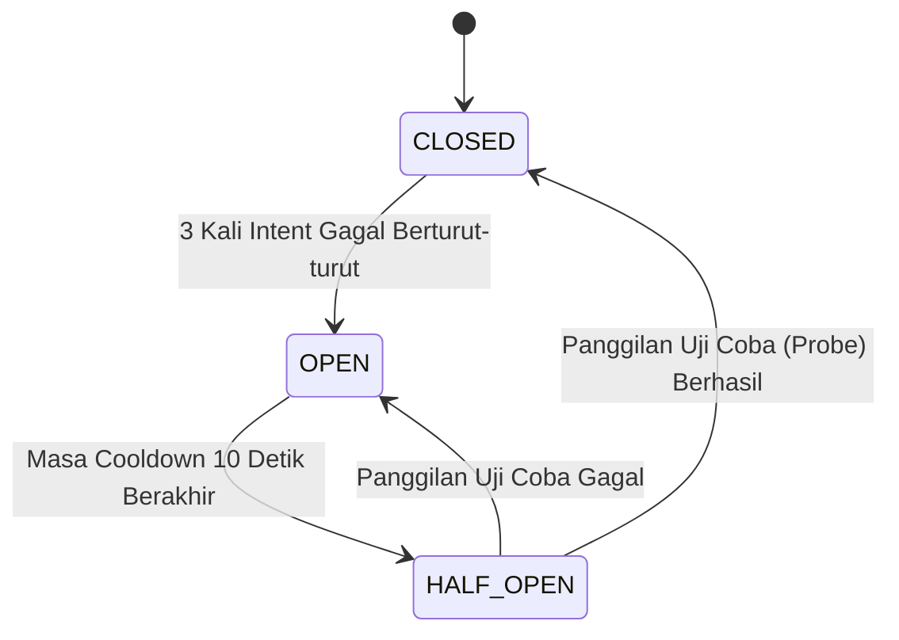

# ⚡ Modul 05: Integrasi Pihak Ketiga & Pola Reliability
**Rujukan Slide: Slide 47 – 64, 71**

Modul ini mengulas pola arsitektur ketahanan sistem (*Resilience Engineering*) saat berinteraksi dengan API pihak ketiga (*Third-Party Dependency*). Ketika server eksternal mengalami gangguan jaringan, kelebihan beban (*overloaded*), atau kegagalan total, API TaskHub harus tetap stabil, tidak mengalami kelumpuhan berantai (*Cascading Outage*), dan menjaga kejelasan status transaksi bisnis.

---

## 🔌 1. Pola Adapter: Memisahkan Domain dari Vendor (Slide 49 & 50)

> [!IMPORTANT]
> **Prinsip Isolasi Arsitektur (Slide 49):**
> *“Controller tidak perlu mengenal spesifikasi atau field vendor.”*
> Controller hanya menangani intent bisnis dan penegakan kebijakan keamanan internal. Seluruh urusan teknis transmisi HTTP, pemetaan struktur JSON vendor (*Data Mapper*), kebijakan retry, dan penerjemahan error dibungkus rapi di dalam **Adapter**.

```
┌─────────────────┐       ┌─────────────────┐       ┌─────────────────┐
│   CONTROLLER    │ ───►  │     ADAPTER     │ ───►  │    PROVIDER     │
│  (Port 8000)    │       │ (Notification   │       │  (Port 8001)    │
│                 │       │   Provider)     │       │                 │
│ • Cek Wewenang  │       │ • HTTP Client   │       │ • Vendor API    │
│ • Validasi OLA  │       │ • Timeout 1500ms│       │ • Idempotency   │
│ • Intent Bisnis │       │ • Retry & Jitter│       │ • Fault Modes   │
│                 │       │ • CircuitBreaker│       │                 │
└─────────────────┘       └─────────────────┘       └─────────────────┘
```

### Alur Integrasi Terkontrol (Slide 50):
1. **Client** mengirimkan intent `POST /api/v1/tasks/:id/notify` ke **TaskHub (port 8000)** dengan membawa token autentikasi dan header `Idempotency-Key`.
2. **TaskHub API** mengecek autentikasi, memvalidasi hak akses BOLA `can_access`, dan memastikan kuota rate limit.
3. **NotificationAdapter** internal memanggil **Provider Mock (port 8001)** dengan timeout terukur.
4. Provider Mock memberikan respons (sukses atau gagal).
5. Adapter menerjemahkan status vendor menjadi respons standar yang dipahami oleh client internal.
6. **Kaidah Mutlak**: Client browser **TIDAK PERNAH** memanggil server pihak ketiga secara langsung!

---

## ⏱️ 2. Timeout vs Deadline (Slide 52 & 53)

- **Timeout**: Batas waktu tunggu maksimum untuk **satu kali pemanggilan jaringan tunggal** (fase I/O). Di Node.js 20+, implementasi standar menggunakan `AbortSignal.timeout(1500)`.
- **Deadline**: Batas waktu total yang dialokasikan untuk **menyelesaikan keseluruhan transaksi bisnis**, mencakup seluruh percobaan awal, percobaan retry, jeda waktu tidur (*sleep/backoff*), dan pemanggilan dependensi sekunder.

### Paradigma Kritis Timeout (Slide 53):
> [!CAUTION]
> **“Tidak Ada Respons ≠ Tidak Ada Efek!” (Slide 53)**
> Ketika panggilan API mengalami timeout (koneksi terputus di tengah jalan):
> - **HASILNYA BELUM DIKETAHUI (*Unknown State*)!**
> - Ada kemungkinan besar server provider **sebenarnya sudah menerima request dan menyelesaikan transaksi** (misal uang sudah terpotong atau SMS sudah terkirim), namun paket respons HTTP gagal kembali ke server Anda karena kabel jaringan putus.
> - **JANGAN PERNAH** langsung mengulang request dengan ID baru! Mengulang tanpa mekanisme idempotensi akan menghasilkan pembayaran ganda atau pesan spam ganda.

---

## 🔁 3. Taksonomi Retry: Kapan Layak & Kapan Dilarang (Slide 54)

Retry membabi-buta adalah salah satu penyebab utama kehancuran sistem terdistribusi (*Self-Inflicted Denial of Service*).

| Status / Kondisi | Layak Di-Retry? | Alasan Teknis & Bisnis (Slide 54) |
| :--- | :---: | :--- |
| **429 (Too Many Requests)** | **LAYAK** | Provider kelebihan beban sementara; tunggu sesuai header `Retry-After`. |
| **502, 503, 504** | **LAYAK** | Gangguan sementara (*transient error*) pada gateway atau infrastruktur vendor. |
| **Timeout / Socket Reset** | **LAYAK** | Masalah koneksi sementara (asalkan dilindungi Idempotency Key!). |
| **Metode GET** | **LAYAK** | Operasi GET bersifat idempoten dan aman (*safe*). |
| **401 / 403 (Unauthorized)** | ❌ **JANGAN** | Masalah kredensial atau wewenang. Retry 1000x pun akan tetap ditolak! |
| **422 (Unprocessable Entity)** | ❌ **JANGAN** | Payload JSON salah format. Harus diperbaiki oleh pembuat kode. |
| **409 (Conflict)** | ❌ **JANGAN** | Konflik intent bisnis (misal kunci sama dengan payload berbeda). |
| **POST Tanpa Idempotensi** | ❌ **JANGAN** | Berisiko fatal menduplikasi transaksi finansial atau efek samping data. |

---

## 📈 4. Exponential Backoff, Jitter, dan `Retry-After` (Slide 55)

Ketika server mendeteksi kegagalan sementara, percobaan ulang tidak boleh ditembakkan seketika:

```
Percobaan 1 (Gagal) ──[Tunggu 200ms + Jitter]──► Percobaan 2 (Gagal) ──[Tunggu 400ms + Jitter]──► Percobaan 3 (Stop!)
```

1. **Exponential Backoff**: Jeda waktu tunggu dilipatgandakan secara eksponensial ($200\text{ ms} \rightarrow 400\text{ ms} \rightarrow 800\text{ ms}$).
2. **Jitter (Variasi Acak)**: Menambahkan angka acak kecil (misal $0 - 100\text{ ms}$) pada durasi tunggu. Ini mencegah fenomena **Thundering Herd** (ribuan klien yang gagal serentak menyerbu server di milidetik yang sama).
3. **Menghormati `Retry-After`**: Jika respons vendor menyertakan header `Retry-After: 2`, adapter wajib mendahulukan instruksi vendor daripada formula internal kita.

> [!WARNING]
> **Tetapkan Satu Pemilik Retry (Slide 55):**
> Jika Frontend me-retry 3x, API Gateway me-retry 3x, dan Worker Background me-retry 3x, maka satu klik pengguna akan memicu:
> $$3 \times 3 \times 3 = 27\text{ request ke vendor eksternal!}$$
> Tetapkan secara tegas lapisan mana yang berwenang melakukan retry (dalam arsitektur TaskHub: NotificationAdapter).

---

## 🔑 5. Idempotency Key & Deteksi Konflik Payload (Slide 56 & 57)

Idempotency Key adalah string unik yang dikirimkan oleh client melalui header `Idempotency-Key` (misal UUIDv4).

### Dua Aturan Baku Penanganan Idempotensi (Slide 56):
1. **Kunci Sama + Payload Sama ➔ Kembalikan Respons yang Sama Persis (Status 200)**:
   - Server tidak mengeksekusi ulang efek samping (tidak mengirim SMS baru), melainkan mengambil salinan respons lama yang tersimpan di basis data SQLite (`idempotency_records`).
2. **Kunci Sama + Payload Berbeda ➔ Tolak Keras dengan Status HTTP 409 Conflict**:
   - Mencegah inkonsistensi data ketika satu kunci unik dicoba digunakan untuk dua maksud bisnis yang berbeda.

```
┌────────────────────────────────────────────────────────────────────────┐
│ TABEL IDEMPOTENCY_RECORDS DI SQLITE PROVIDER MOCK (Slide 56)           │
├──────────────────┬──────────────────┬──────────┬───────────────────────┤
│ idempotency_key  │ payload_hash     │ status   │ response_body         │
├──────────────────┼──────────────────┼──────────┼───────────────────────┤
│ notify-demo-001  │ a4f8e... (SHA256)│ 200      │ {"notificationId":"1"}│
└──────────────────┴──────────────────┴──────────┴───────────────────────┘
```

> [!NOTE]
> Slide 56 mengingatkan: *“Tanpa penyimpanan hasil (rekonsiliasi) di server/provider, Idempotency Key tidak memberikan jaminan apa-apa!”*

---

## 🛑 6. Pola Circuit Breaker: Tiga Status (Slide 58 – 60)

Circuit Breaker adalah sakelar otomatis yang mencegah server terus-menerus membuang sumber daya ke sistem eksternal yang sedang sekarat:



### Tiga Status Sirkuit:
1. **CLOSED (Normal / Tertutup)**:
   - Arus lalu lintas diizinkan lewat secara bebas.
   - Kegagalan dependency dihitung secara akumulatif.
2. **OPEN (Jeglek / Terbuka)**:
   - Dipicu ketika kegagalan mencapai batas toleransi (**3 intent gagal berturut-turut**).
   - Seluruh pemanggilan berikutnya **LANGSUNG DITOLAK** di milidetik ke-0 dengan status **HTTP 503 CIRCUIT_OPEN** tanpa memanggil provider (Slide 69).
   - Sirkuit memasuki masa istirahat (*cooldown*) selama **10 detik** (10.000 ms).
3. **HALF-OPEN (Uji Pemulihan / Setengah Terbuka)**:
   - Setelah 10 detik berakhir, sirkuit membuka celah kecil untuk satu panggilan uji coba (*probe*).
   - Jika panggilan uji coba berhasil, sirkuit kembali ke status **CLOSED**. Jika gagal, sirkuit kembali jeglek ke status **OPEN** selama 10 detik lagi.

### Implementasi Kelas Circuit di TaskHub (Slide 59 & 60):
```javascript
// src/services/circuitBreaker.js
class Circuit {
  failures = 0;
  until = 0;

  blocked() {
    return Date.now() < this.until;
  }

  result(ok) {
    if (ok) {
      this.failures = 0;
      this.until = 0;
    } else {
      this.failures += 1;
      // Jika 3 kali gagal berturut-turut, kunci sirkuit selama 10 detik
      if (this.failures >= 3) {
        this.until = Date.now() + 10_000;
      }
    }
  }
}
```

---

## 🚢 7. Pola Bulkhead & Fallback Bisnis yang Aman (Slide 64)

- **Bulkhead Pattern**: Diilhami dari sekat kedap air pada lambung kapal Titanic. Dalam arsitektur perangkat lunak, Bulkhead membatasi jumlah koneksi (*connection pool*) dan worker thread per vendor eksternal. Jika provider notifikasi mengalami lonjakan antrean, connection pool untuk database atau payment gateway tidak ikut tersedot habis.
- **Fallback Bisnis yang Aman**:
  - *Menunda notifikasi ke antrean background job*: **BOLEH & AMAN SECARA BISNIS**.
  - *Menganggap transaksi pembayaran berhasil saat server bank mati*: **DILARANG KERAS KARENA MERUPAKAN PENIPUAN FINANSIAL!**
  - Catat status transaksi sebagai `PENDING` atau `UNKNOWN`, lalu jalankan proses rekonsiliasi berkala.

---

## 🌐 8. Pencegahan SSRF pada Integrasi Eksternal (Slide 71)

**SSRF (Server-Side Request Forgery)** terjadi ketika penyerang dapat memanipulasi parameter URL tujuan yang dipanggil oleh server backend.

> [!CAUTION]
> **Kontrol Mutlak Anti-SSRF (Slide 71):**
> 1. Jangan pernah mengizinkan pengguna mengirimkan URL sembarang untuk dipanggil oleh server!
> 2. Di TaskHub, alamat endpoint vendor bersifat tetap (*Fixed URL*) yang dibaca dari variabel lingkungan `PROVIDER_BASE_URL`.
> 3. Alamat loopback `127.0.0.1` **hanya diizinkan secara khusus** untuk tujuan mock laboratorium pelatihan, dan wajib diblokir di jaringan produksi guna mencegah peretas menjangkau metadata cloud internal (`http://169.254.169.254`).
